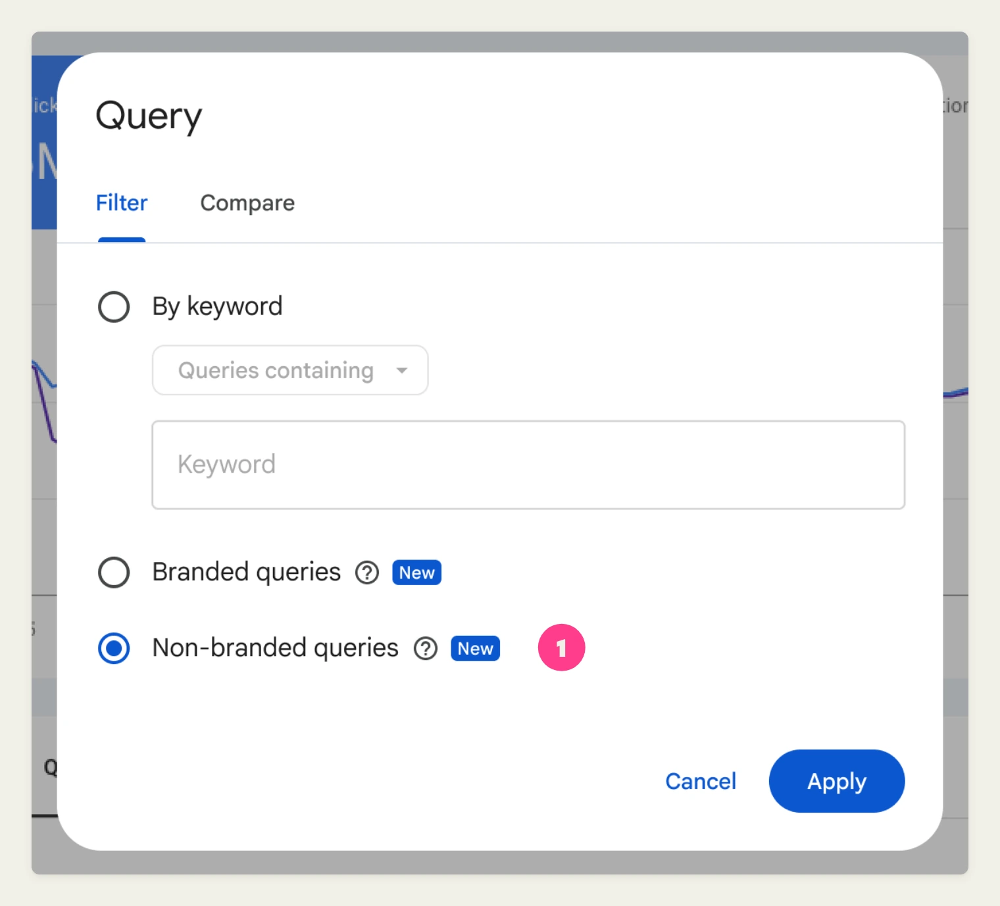
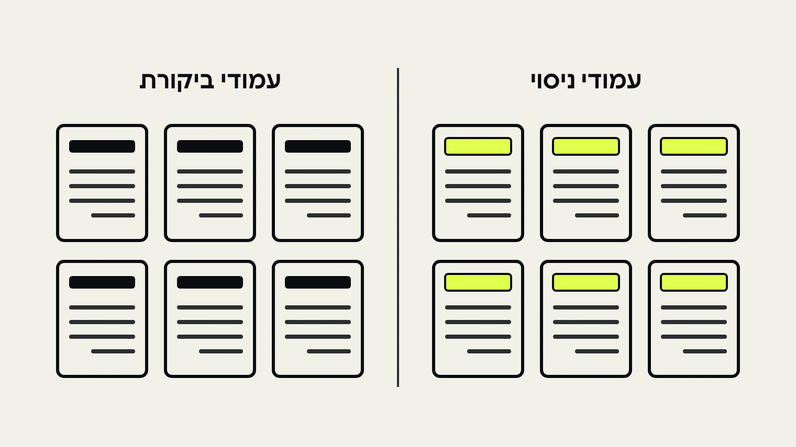
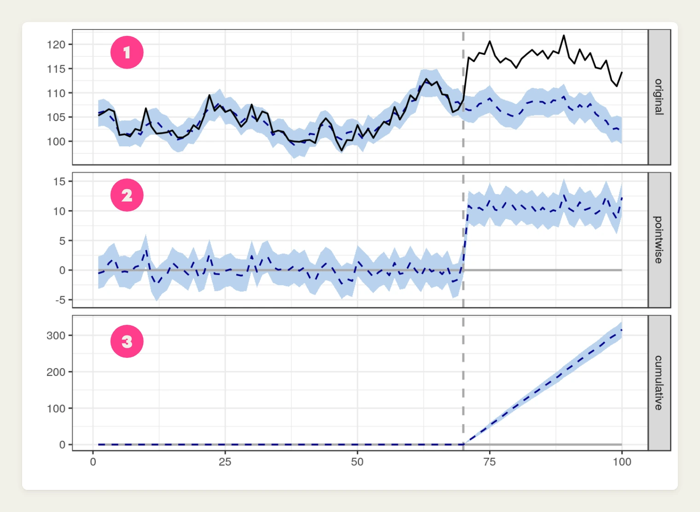
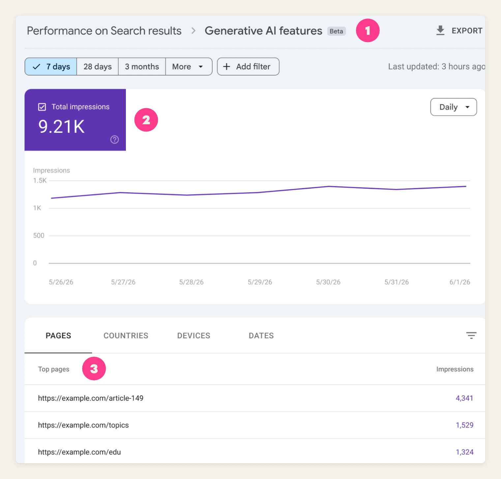

# בדיקות A/B ל-SEO ב-2027, איך מוכיחים ששינוי באמת עבד

שיניתם את הכותרות בעמודי המוצר במרץ, באפריל ההקלקות עלו, וכולם בחדר הנהנו. ואז מישהו מההנהלה שאל איך אתם יודעים שזה לא פשוט גוגל. גרף של לפני ואחרי לא עונה על השאלה הזאת, כי עדכוני ליבה, עונתיות ותשובות ה-AI של גוגל מזיזים את התנועה גם כשאף אחד לא נוגע באתר.

בדיקת A/B ל-SEO, שנקראת גם בדיקת ספליט (SEO Split Testing), נועדה בדיוק לזה, והיא אחד הכלים שהופכים [קידום אורגני](/services/seo) לערוץ שאפשר למדוד. במדריך נעבור על מה נחשב הוכחה, איך הבדיקה עובדת, איזו שיטה מתאימה לגודל האתר שלכם ואיך מציגים תוצאה שגם סמנכ"ל כספים יקבל. הבסיס הוא [מאמר של סופי ברנון ב-Search Engine Journal](https://www.searchenginejournal.com/seo-split-testing-prove-change-worked/594529/), שותפה-מייסדת בסוכנות StudioHawk US, שעיבדנו לעברית ובדקנו מול המקורות של גוגל.

## בקצרה — הנקודות החשובות

- גרף של לפני ואחרי מראה שמשהו השתנה, לא מה גרם לשינוי. השאלה הנכונה היא בכמה התנועה עלתה מעבר למה שהיה קורה בלי השינוי.
- בדיקת A/B ל-SEO, או בדיקת ספליט, מחלקת עמודים ולא גולשים. חלק מהעמודים באותה תבנית מקבלים את השינוי, והשאר נשארים כקבוצת ביקורת.
- לפני שמתחילים כותבים דף אחד עם השערה, מדד ראשי, מדדי מגן, תאריך ניתוח וכלל החלטה.
- לפי SearchPilot, בדיקה קלאסית דורשת כ-1,000 כניסות אורגניות ביום לאזור הנבדק. באתר קטן יותר מחזקים השוואת לפני ואחרי בעזרת קבוצת עמודים שלא נוגעים בה.
- מדווחים טווח ולא מספר בודד, מחברים להכנסות או ללידים, ומדווחים גם על הבדיקות שלא הצליחו.

## למה "התנועה עלתה" זו לא הוכחה?

השוואת לפני ואחרי מראה שמשהו השתנה. היא לא יכולה להגיד מה גרם לשינוי, כי על התנועה האורגנית של כל קבוצת עמודים פועלים כמה כוחות בו בזמן:

- עונתיות ושינויים בביקוש.
- עדכוני אלגוריתם ועדכוני ליבה.
- מתחרים ששיפרו את האתר שלהם, או שברו אותו.
- קמפיינים, יחסי ציבור ופרסום ממומן שמעלים את החיפושים על שם המותג.
- תקלות מדידה, כמו תג GA4 שנשבר או באנר הסכמה לעוגיות שהשתנה.

לכל אלה נוסף דף התוצאות עצמו. [AI Overviews](/knowledge/guides/ai-overviews-hebrew) ו-AI Mode יכולים לשנות את מספר ההקלקות גם כשהמיקום שלכם לא זז, וגוגל כוללת את הנתונים מהתכונות האלה [בדוח הביצועים הכללי של Search Console](https://developers.google.com/search/blog/2026/06/gen-ai-performance-reports).

לכן לא מספיק לשאול אם התנועה עלתה. שואלים בכמה היא עלתה מעבר למה שהיה קורה בלי השינוי. לאומדן הזה קוראים תרחיש נגדי (counterfactual), וכל בדיקת SEO רצינית היא בסופו של דבר דרך לבנות אותו.

## איך נראית הוכחה שמחזיקה מול הנהלה?

הוכחה כזאת בנויה משני חלקים: מה שיש בתוצאה עצמה, ומה שסוכם לפני שהבדיקה התחילה.

### ארבעת המרכיבים של תוצאה אמינה

לפי ברנון, מאחורי תוצאה שעומדת מול צוות כספים יש כמעט תמיד ארבעה דברים:

- **השוואה הוגנת.** עמודים דומים שלא קיבלו את השינוי, שנמדדו באותם תאריכים.
- **טווח ולא מספר בודד.** "ההקלקות עלו ב-14%" מזמין ויכוח. "המודל מעריך עלייה של 8% עד 19%" הרבה יותר קשה להפריך.
- **תוצאה עסקית.** הקלקות ומיקומים הם מדדים מקדימים. הכנסות או לידים מהעמודים שנבדקו הם מה שמעניין את ההנהלה.
- **כלל החלטה שנקבע לפני שהבדיקה מתחילה.** זה הסעיף שרוב הצוותים מדלגים עליו.

הסעיף האחרון הוא הלב. מי שבוחר את המדד ואת הגדרת ההצלחה אחרי שראה את הנתונים, תמיד ימצא דרך לקרוא לתוצאה ניצחון.

הוא גם מכריח להחליט בשביל מה השינוי בכלל. שכתוב של תגית title אמור להזיז הקלקות מהחיפוש. שינוי בפריסת העמוד שנועד לעזור לגולשים להשוות בין מוצרים הוא קודם כל בדיקת המרה, ומדדי החיפוש משמשים בה רק כמדד מגן.

### דף הבדיקה שכותבים מראש

הפתרון הוא מסמך קצר שנכתב ומשותף לפני שמשהו עולה לאוויר:

- **ההשערה.** מה משנים ולמה אתם חושבים שזה יעזור.
- **המדד הראשי.** ברוב השינויים בעמוד אלה הקלקות אורגניות שאינן על שם המותג, לעמודים שנבדקים. Search Console [משמיט שאילתות אנונימיות](https://developers.google.com/search/blog/2022/10/performance-data-deep-dive) ברגע שמסננים לפי שאילתה, ולכן עוקבים במקביל גם אחרי סך ההקלקות לאותם עמודים.
- **מדדי מגן.** מדדים שאסור להם לרדת מעבר לגבול שסוכם, למשל שיעור ההמרה.
- **העלייה הקטנה ביותר ששווה לפעול בגללה.** בודקים מול נתוני העבר אם לבדיקה יש סיכוי טוב לזהות עלייה בגודל הזה בזמן שיש לכם. אם אין, עדיף לא להריץ אותה עדיין.
- **תאריך הניתוח.** בשבועות מלאים, כדי שכל יום בשבוע יקבל ייצוג שווה.
- **כלל ההחלטה.** איזו תוצאה פירושה להרחיב לכל האתר, איזו פירושה לבטל, ואיזו נרשמת כלא חד-משמעית.

*1 הסינון Non-branded queries ב-Search Console מפריד את ההקלקות שאינן על שם המותג, המדד הראשי ברוב בדיקות ה-SEO. מקור: [Google Search Central](https://developers.google.com/search/blog/2025/11/search-console-branded-filter).*

הסינון הזה זמין לנכסים שעומדים בתנאים של גוגל, וגוגל עצמה מציינת שחלק מהשאילתות עלולות להיות מסווגות לא נכון. לכן שווה להצליב אותו עם סינון regex על שמות המותג שלכם.

דף הבדיקה כמעט אף פעם לא ארוך מעמוד אחד, והוא משנה את השיחה בסוף. במקום לשאול אם מאמינים לכם, שואלים אם השינוי עבר את המבחן שסיכמתם עליו.

## איך בדיקת ספליט ב-SEO עובדת?

בדיקת ספליט ב-SEO מחלקת עמודים במקום אנשים. מבלבלים אותה לעיתים קרובות עם בדיקות A/B רגילות של אופטימיזציית המרות (CRO), שמחלקות גולשים בין שתי גרסאות של אותו עמוד, אבל ב-SEO זה לא עובד.

גוגל מדרגת גרסה אחת של כל כתובת, ולכן חלוקת גולשים לא יכולה להראות איך שינוי משפיע על דירוג או על הקלקות מהחיפוש. ולהציג לגוגלבוט עמוד אחד ולגולשים עמוד אחר זה cloaking (הסוואה). [ההנחיות של גוגל לבדיקות באתר](https://developers.google.com/search/docs/crawling-indexing/website-testing) קובעות שהסוואה מנוגדת למדיניות הספאם "בין אם אתם מריצים בדיקה ובין אם לא".

אז לוקחים קבוצה של עמודים שבנויים על אותה תבנית, כמו עמודי מוצר, קטגוריה או סניף, ומחלקים אותה לשתיים. עמודי הניסוי מקבלים את השינוי, ועמודי הביקורת נשארים בדיוק כפי שהם.

*עמודים מאותה תבנית מחולקים לשתי קבוצות. מימין עמודי הניסוי, שקיבלו את השינוי. משמאל עמודי הביקורת, שנשארו כפי שהם. מקור: Bebop.*

ארבעה דברים קובעים אם הבדיקה שווה משהו:

1. **קבוצות תואמות.** שתי הקבוצות צריכות להתנהג באותה צורה לפני שהבדיקה מתחילה. עמודים שמתחרים על אותן שאילתות נשארים יחד כיחידה אחת, אחרת עמוד ניסוי מנצח פשוט ייקח הקלקות מהתאום שלו בקבוצת הביקורת. אחר כך מתאימים בין היחידות לפי רמת תנועה וקטגוריה ומחלקים אותן באקראי.

2. **ריצה במקביל.** שתי הקבוצות נמדדות באותם תאריכים, כך שעדכון ליבה או קפיצה של חג פוגעים בשתיהן באותו זמן. זה לא מבטיח שהן יגיבו אותו דבר, כי עדכון יכול לפגוע בקטגוריות מסוימות יותר מבאחרות. בגלל זה ההתאמה והבדיקה המקדימה חשובות.
3. **תחזית.** קבוצת הביקורת משמשת כדי לחזות מה עמודי הניסוי היו עושים בלי השינוי. הפער בין התחזית לבין מה שקרה בפועל הוא התוצאה.

4. **בדיקה מקדימה.** בוחרים כמה תאריכי השקה מדומים בעבר, מאמנים את המודל על הנתונים שלפני כל אחד מהם ובודקים עד כמה הוא חוזה את השבועות שאחריו, בחלונות באורך הבדיקה המתוכננת. מודל ש"מוצא" השפעות בתקופות שבהן לא קרה כלום לא יוכל להגיד מה השינוי שלכם עשה.

המודל המוכר ביותר לבניית התחזית הוא [CausalImpact](https://google.github.io/CausalImpact/CausalImpact.html), חבילת קוד פתוח של גוגל. SearchPilot, פלטפורמה ייעודית לבדיקות SEO, התחילה איתו ו[עברה ב-2019 למודל רשת נוירונים](https://www.searchpilot.com/resources/blog/an-update-on-split-optimizer-searchpilots-neural-network-model) כדי לזהות עליות קטנות יותר.

*דוגמה מהתיעוד של CausalImpact. 1 הנתונים בפועל (קו רציף) מול התחזית (קו מקווקו). 2 הפער ביניהם בכל נקודה. 3 הפער המצטבר. הקו האנכי מסמן את יום השינוי. מקור: [CausalImpact, Google](https://google.github.io/CausalImpact/CausalImpact.html).*

## איזו שיטה מתאימה לאתר שלכם?

לא כל אתר יכול להריץ בדיקת ספליט קלאסית. כלל האצבע של SearchPilot הוא שהאזור שבודקים צריך לקבל [כ-1,000 כניסות אורגניות ביום](https://www.searchpilot.com/resources/blog/before-you-begin-seo-testing). מתחת לזה בדיקות נוטות להימרח או לא להגיע לתשובה ברורה.

זה לא אומר שאתר קטן לא יכול לבדוק. זה אומר שבוחרים את השיטה הנכונה, ומודים ביושר עד כמה הראיה חזקה.

| שיטה | מאיפה מגיעה ההשוואה | למי מתאים | ממה להיזהר |
|---|---|---|---|
| חלוקת עמודים | עמודים באותה תבנית שלא שונו, באותם תאריכים | אתרים גדולים עם תבניות, כמו חנויות אונליין, מרקטפלייסים, אתרי תוכן ורשתות עם סניפים רבים | דורש היקף תנועה ויכולת להעלות שינוי רק לחלק מהעמודים |
| חלוקה גאוגרפית | שווקים או אזורים שבהם השינוי לא עלה | אתרים בינלאומיים, זכיינות וקידום מקומי | שווקים כמעט אף פעם לא מתנהגים זהה, ולכן מתאימים ביניהם לפי מגמות עבר |
| קו בסיס ממודל | נתונים שהשינוי לא יכול היה לגעת בהם, כמו שווקים דומים או נתוני ביקוש חיצוניים | שינויים רוחביים בלי קבוצת ביקורת נקייה, כמו שינוי בתפריט | חלש אם גם נתוני ההשוואה הושפעו מהשינוי |
| לפני ואחרי | הביצועים הקודמים של אותם עמודים | אתרים קטנים ועמודים בודדים | לא מפריד בין השינוי שלכם לבין עונתיות או עדכונים |

אם נשארתם עם השוואת לפני ואחרי, עדיין אפשר לחזק אותה מאוד:

- שומרים בצד קבוצה של עמודים דומים שבכוונה לא נוגעים בהם. זה מקרב אתכם מאוד לבדיקה אמיתית.
- מפרידים את הביקוש למותג בעזרת סינון Non-branded queries שראינו למעלה.
- מוסיפים [הערה מותאמת אישית](https://developers.google.com/search/blog/2025/11/custom-chart-annotations) על גרף הביצועים ב-Search Console ביום שבו השינוי עלה. קליק ימני על הגרף, Add annotation, ועד 120 תווים של הסבר.

הכלים מתחלקים באותה צורה. פלטפורמות ארגוניות כמו SearchPilot ו-seoClarity מטפלות בהעלאת השינוי ובמודל, SEOTesting.com מריץ בדיקות על בסיס נתוני Search Console לאתרים קטנים יותר, ו-CausalImpact חינמי למי שיש לו אנליסט בבית. אם מערכת הניהול שלכם כבר מאפשרת לשנות רק חלק מהעמודים בתבנית, ייתכן שלבדיקות הראשונות לא תצטרכו פלטפורמה בכלל.

## אילו מספרים מציגים בדוח?

דוח טוב של בדיקת ספליט צריך קומץ מספרים, ואף אחד מהם לא עומד לבד.

**העלייה מול התחזית.** ההפרש בין מה שעמודי הניסוי עשו לבין מה שהמודל ציפה. זו הכותרת של הדוח.

**הטווח.** טווח ההשפעות שהמודל רואה כסבירות. יש כלים שקוראים לו רווח סמך ויש שקוראים לו טווח אמינות (credible interval). כך או כך, אם הטווח כולל אפס, התוצאה לא מראה השפעה חיובית.

**ההסתברות להשפעה חיובית.** המספר שהכי קל להסביר למי שאינו טכני, אבל כדאי לבדוק מה הכלי שלכם מדווח בפועל. ברנון מציינת שהמדד "הסתברות להשפעה סיבתית" של CausalImpact לא אומר לאיזה כיוון, כך שהפסד ודאי יכול לקבל ציון גבוה כמו ניצחון. וגם 90% הסתברות להשפעה חיובית משאירים סיכוי של אחד לעשרה שהשינוי לא עשה כלום או הזיק.

**הכנסות או המרות מהעמודים שנבדקו.** המספר שהופך תוצאת SEO לטיעון עסקי. הכנסות רועשות יותר מהקלקות, ולכן כשהנפחים קטנים מציגים אותן ככיוון ולא כהוכחה.

מיקומים יכולים לעזור להסביר למה ההקלקות זזו, כל עוד משווים גם אותם מול קבוצת הביקורת. לבדם הם אף פעם לא הוכחה.

## מה עם נראות בתשובות ה-AI של גוגל?

אפשר למדוד גם אותה. לפי גוגל, מאז 31 באוגוסט 2026 דוחות הביצועים של תכונות ה-AI הגנרטיבי ב-Search Console [זמינים לכל האתרים בעולם](https://developers.google.com/search/blog/2026/06/gen-ai-performance-reports). הם מראים כמה פעמים העמודים שלכם הופיעו ב-AI Overviews וב-AI Mode, בפירוט לפי עמוד.

*דוח Generative AI features ב-Search Console. 1 שם הדוח, תחת Performance on Search results. 2 סך החשיפות בתכונות ה-AI. 3 הפירוט לפי עמוד, שמאפשר להשוות בין עמודי הניסוי לעמודי הביקורת. מקור: [Google Search Central](https://developers.google.com/search/blog/2026/06/gen-ai-performance-reports).*

בבדיקות זה אומר שאפשר להשוות חשיפות בתכונות ה-AI בין קבוצת הניסוי לקבוצת הביקורת, כמו שמשווים הקלקות. אם שינוי מעלה הקלקות אבל מוריד נראות ב-AI, או להפך, שווה להבין למה לפני שמרחיבים אותו לכל האתר.

הדוח מציג חשיפות ולא הקלקות, ולכן מתייחסים אליו כאות תומך. מי שרוצה רקע על הצד הזה ימצא אותו במדריך [מה זה GEO](/knowledge/guides/what-is-geo).

## דוגמה לבדיקה מתחילתה ועד סופה

כך נראית בדיקה נקייה. הדוגמה והמספרים לקוחים מהמאמר של ברנון והם להמחשה בלבד, אבל זו הצורה שכדאי לשאוף אליה לפני שנכנסים לחדר הישיבות.

**השינוי.** תבנית חדשה ל-title ולתיאור המטא ב[עמודי מוצר](/knowledge/guides/google-store-seo), שפותחת במה שהגולש מחפש במקום בשם המותג.

**דף הבדיקה.** המדד הראשי הוא הקלקות אורגניות שאינן על שם המותג. שיעור ההמרה לא יכול לרדת ביותר מ-2% ביחס לביקורת. העלייה הקטנה ביותר ששווה לפעול בגללה היא 5%, ותאריך הניתוח הוא שישה שבועות אחרי ההשקה. התבנית מורחבת רק אם טווח ה-95% כולו מעל אפס, האומדן המרכזי עובר 5% ומדד המגן נשמר.

**החלוקה.** 400 עמודי מוצר, מקובצים כך שעמודים שמתחרים על אותן שאילתות נשארים יחד, מותאמים לפי תנועה וקטגוריה ומחולקים באקראי. יוצאים בערך 200 עמודי ניסוי ו-200 עמודי ביקורת, וההגדרה עוברת את הבדיקה המקדימה.

**התוצאה.** אחרי שישה שבועות עמודי הניסוי מקבלים 14.2% יותר הקלקות לא ממותגות מהתחזית, עם טווח של 8% עד 19% ברמת 95%. המודל מעריך את ההסתברות להשפעה חיובית ביותר מ-99%, ונתוני ההמרה שוללים ירידה מעבר ל-2%. הטווח עולה כולו מעל האפס לראשונה ביום ה-27, אבל הבדיקה ממשיכה עד התאריך שסוכם, וההשפעה מחזיקה.

**התוצאה העסקית.** ההכנסה האורגנית מכניסות לעמודי הניסוי גבוהה ב-9.6% מהתחזית שלה. הטווח שלה רחב בהרבה, ולכן מדווחים עליה ככיוון. המיקום הממוצע בביטויי היעד עובר מ-6.4 ל-4.8 בזמן שקבוצת הביקורת נשארת יציבה, וזה מסביר מאיפה הגיעו ההקלקות.

**ההחלטה.** התבנית עולה לשאר עמודי המוצר. מכאן רק עוקבים שהעלייה נשמרת, כי כבר אין קבוצת ביקורת שתוכיח אותה.

רוב הבדיקות לא ייראו מסודרות כל כך. ב-2024 SearchPilot הריצה מחדש מדגם של בדיקות עבר במודל החדש שלה, ו[29% מהן יצאו חיוביות ברמת ביטחון של 95%](https://www.searchpilot.com/resources/blog/an-update-on-split-optimizer-searchpilots-neural-network-model), לעומת 13% במודל הקודם. כלומר גם עם מודל ייעודי, רוב הבדיקות במדגם לא הראו ניצחון מובהק. זה לא אומר שהשינויים לא עשו כלום, אבל כדאי לזכור את זה לפני שדוחפים שינוי לכל האתר.

## איך מדווחים תוצאות כך שיאמינו לכם?

פותחים בהחלטה ולא במתודולוגיה. רוב מקבלי ההחלטות רוצים לדעת שלושה דברים: מה אתם ממליצים, כמה אתם בטוחים וכמה זה שווה. דוח של עמוד אחד שעונה על זה כולל בדרך כלל:

- **ההמלצה.** להרחיב, לבטל או לרשום כלא חד-משמעי.
- **התוצאה במשפט אחד.** למשל, "המודל מעריך שהתבנית החדשה העלתה את ההקלקות הלא ממותגות לעמודי המוצר שנבדקו ב-8% עד 19%".
- **כמה זה שווה.** הכנסות או לידים מהעמודים שנבדקו, ותחזית להרחבה עם ההנחות שלה כתובות במפורש.
- **איך בדקתם.** העמודים, החלוקה, התאריכים והשיטה, וכל מה שקרה בזמן הבדיקה, כמו עדכון ליבה.
- **מה הלאה.** הבדיקה הבאה בתור.

בתחזית מתחילים מהקצה השמרני של הטווח, מסבירים במה שאר העמודים שונים מאלה שנבדקו וקוראים לזה תרחיש ולא תוצאה. הרחבה שעוקפת מספר שמרני בונה אמון. הרחבה שמפספסת מספר אופטימי שוחקת אותו.

ומדווחים גם על המפסידים. יומן בדיקות שיש בו רק ניצחונות נראה כמו בחירה סלקטיבית, כי זה מה שהוא. התוצאות השליליות והלא חד-משמעיות הן מה שהופך את הניצחונות לאמינים.

## טעויות שפוסלות בדיקה בשקט

שתי טעויות חוזרות, ושתיהן לא נראות בדוח הסופי אם לא מחפשים אותן.

### לעצור כשזה נראה טוב

עוקבים כל יום כדי לתפוס תקלות יישום, אבל מחליטים בתאריך הניתוח שנקבע מראש, אלא אם הפלטפורמה שלכם משתמשת בשיטה שנבנתה לניטור רציף. מי שמכריז על תוצאה בפעם הראשונה שהיא חוצה את הקו, מגדיל מאוד את הסיכוי להרחיב שינוי שלא באמת עובד.

### לא לוודא שגוגל ראתה את השינוי

חלק מהכלים מחילים שינויים ב-JavaScript. בכלי בדיקת כתובת האתר (URL Inspection) ב-Search Console מוודאים שהשינוי מופיע ב-HTML אחרי רינדור, ושעמודי הניסוי נסרקו מחדש מאז שעלה.

בבדיקות title בודקים גם מה גוגל מציגה בפועל. גוגל [עשויה לשנות את כותרת התוצאה](https://developers.google.com/search/docs/appearance/title-link) כשהיא מעריכה שתגית ה-title לא משקפת את תוכן העמוד, כך שהכותרת שאתם בודקים היא לא תמיד זו שהגולשים רואים.

## שאלות נפוצות

### כמה זמן צריכה בדיקת ספליט לרוץ?

אין מספר קבוע. קובעים את המשך מראש, בשבועות מלאים, לפי כמות התנועה באזור הנבדק ולפי גודל העלייה שרוצים לזהות. בדוגמה שבמדריך הבדיקה רצה שישה שבועות. אם החישוב מראה שבזמן שיש לכם אין סיכוי סביר לזהות את העלייה, עדיף לדחות את הבדיקה או לבחור שינוי גדול יותר.

### האם בדיקת ספליט יכולה לפגוע בדירוג?

השינוי עצמו יכול, וזו בדיוק הסיבה לבדוק אותו על חלק מהעמודים לפני שמרחיבים. אם עמודי הניסוי יורדים מול התחזית, מבטלים את השינוי והנזק נשאר מוגבל לקבוצה קטנה. הבדיקה כשיטה לא מסכנת את האתר כל עוד גוגלבוט והגולשים רואים את אותו עמוד.

### מה עושים כשהתוצאה לא חד-משמעית?

רושמים אותה ביומן הבדיקות כפי שהיא, ולא מציגים אותה כניצחון. תוצאה כזאת לא אומרת שהשינוי חסר ערך, רק שהבדיקה לא הצליחה להבחין בהשפעה. מה עושים במקרה כזה מחליטים מראש בכלל ההחלטה, למשל לא להרחיב או להריץ שוב על קבוצת עמודים גדולה יותר.

## בשורה התחתונה

בדיקת ספליט לא תהפוך כל שינוי לניצחון, והרבה מהם לא יהיו. מה שהיא כן עושה הוא להחליף את "תסמכו עלינו" בתוצאה שההנהלה יכולה לבדוק בעצמה, באותו רף שבו נמדד כל ערוץ אחר בתקציב.

ארבעת ההרגלים חוזרים בכל גודל אתר: כותבים את דף הבדיקה לפני שמתחילים, משווים מול קבוצת ביקורת הוגנת, מדווחים טווח במקום מספר בודד ומחברים את התוצאה להכנסות או ללידים. מי שעושה את זה בעקביות יכול לענות ברצינות כששואלים אותו איך הוא יודע שזה לא פשוט גוגל.

הצעד הראשון קטן. בשינוי הבא שאתם מתכננים, בחרו קבוצת עמודים דומים שלא תיגעו בה והוסיפו הערה ב-Search Console ביום ההשקה. אם תרצו לחשוב יחד איזו שיטת בדיקה מתאימה לאתר שלכם, אפשר להתחיל ב[אבחון אתר](/diagnosis).
